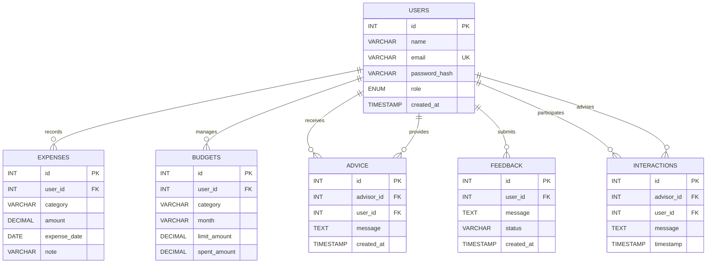

# Online Personal Finance Management Platform

A Java-based personal finance management system developed to demonstrate core Java programming concepts, object-oriented design, JDBC database operations, transaction management, collections, generics, exception handling, and multithreading.

The platform models three roles: **Admin, Financial Advisor, and User**. Its current version focuses on the Java backend and console-based demonstrations, with a web interface planned for the next development phase.

**Project status:** Review 1 — Core Java backend implemented; web layer planned for Review 2.

**Repository:** [GitHub — personal-finance-management](https://github.com/Taqi-Warsi/personal-finance-management)

---

## Table of Contents

- [Project Overview](#project-overview)
- [Objectives](#objectives)
- [Features](#features)
- [Technologies Used](#technologies-used)
- [System Architecture](#system-architecture)
- [Database Design](#database-design)
- [Project Structure](#project-structure)
- [Prerequisites](#prerequisites)
- [Installation and Setup](#installation-and-setup)
- [How to Run](#how-to-run)
- [Demo Guide](#demo-guide)
- [Java Concepts Demonstrated](#java-concepts-demonstrated)
- [Exception Handling](#exception-handling)
- [Security Considerations](#security-considerations)
- [Testing and Verification](#testing-and-verification)
- [Current Limitations](#current-limitations)
- [Future Enhancements](#future-enhancements)
- [Contributing](#contributing)

---

## Project Overview

Managing personal finances involves recording expenses, setting budgets, monitoring spending, and making informed financial decisions.

The Online Personal Finance Management Platform provides a Java backend that models these operations and demonstrates how a layered application can interact with a relational database.

The project uses JDBC and MySQL for persistent data operations. Its service layer coordinates business logic, while the Data Access Object (DAO) layer handles database queries and updates.

The current implementation is intended for academic demonstration and backend learning. It is not yet a complete, production-ready financial application.

## Objectives

- Apply object-oriented programming principles to a practical application.
- Implement database operations using JDBC and MySQL.
- Organize code using a layered architecture.
- Manage expenses and budgets with validation.
- Demonstrate transaction commit and rollback.
- Use Java collections, generics, streams, and custom exceptions.
- Demonstrate multithreading and synchronization.
- Establish a foundation for a role-based web application.

## Features

### Expense Management

- Create and retrieve expense records.
- Organize expenses by category and date.
- Associate expenses with individual users.
- Use `BigDecimal` for monetary calculations.
- Validate expenses against available budget limits.

### Budget Management

- Create and retrieve budget records.
- Maintain category-based monthly budgets.
- Track spending against budget limits.
- Reject expenses that exceed configured limits.
- Demonstrate transactional updates to expense and budget data.

### Financial Reporting

- Group expenses by category.
- Calculate spending totals.
- Identify top spending categories.
- Sort budgets by usage.
- Use Java collections, streams, and collectors to process financial data.

### Role-Based Domain Model

The application models three user roles:

- **Admin:** Represents the administrative role.
- **Financial Advisor:** Represents a role that provides financial advice.
- **User:** Represents an individual managing personal finances.

The domain model uses an abstract base class, subclasses, interfaces, and permission-related logic.

### Financial Advice, Feedback, and Interactions

- Store financial advice associated with advisors and users.
- Maintain user feedback records and their status.
- Record interactions between advisors and users.
- Demonstrate database operations through dedicated DAO classes.

### Multithreading and Synchronization

- Monitor budget utilization in a background task.
- Generate alerts when spending reaches at least 80% of the budget.
- Compare synchronized and unsynchronized shared-state updates.
- Demonstrate synchronization in expense-processing logic.

### Database Transaction Management

The expense service coordinates related database operations in a transaction.

If an operation fails, the transaction can be rolled back to prevent an expense insertion and its corresponding budget update from being committed separately.

---

## Technologies Used

| Technology | Purpose |
|---|---|
| Java 17 | Core application logic and object-oriented design |
| Maven | Dependency management and project building |
| JDBC | Database connectivity and SQL execution |
| MySQL 8 | Relational database |
| MySQL Connector/J 8.4.0 | JDBC driver |
| JUnit 5 | Testing dependency |
| Git and GitHub | Version control and source-code hosting |

**No ORM is used:** database operations are implemented using JDBC and `PreparedStatement`.

---

## System Architecture

The project follows a layered architecture that separates domain models, business logic, and database operations.

```text
             Main / Demo Runner
                     |
                     v
              Service Layer
       ExpenseService, ReportService,
                AccessControl
                     |
                     v
                DAO Layer
       UserDao, ExpenseDao, BudgetDao,
       AdviceDao, FeedbackDao,
              InteractionDao
                     |
                     v
                 JDBC
                     |
                     v
               MySQL Database
                  pfm_db
```

### Layer Responsibilities

**Model Layer**

Contains domain classes, including users, expenses, budgets, advice, feedback, and interactions. It also defines relevant interfaces and the role enumeration.

**Service Layer**

Coordinates business operations, transaction management, report generation, and access-control checks.

**DAO Layer**

Encapsulates SQL queries and database operations. It separates persistence logic from business logic.

**Utility Layer**

Provides database connection functionality using configuration properties.

**Thread Layer**

Contains the background budget-monitoring and synchronization demonstrations.

**Exception Layer**

Defines application-specific exceptions for invalid budgets, insufficient data, unauthorized access, and database access failures.

### Design Principle

Services call DAOs, and DAOs perform JDBC operations. SQL queries are kept within the DAO layer rather than scattered throughout the application.

---

## Database Design

The database is named `pfm_db` and is created by `schema.sql`.

It contains six tables:

| Table | Purpose |
|---|---|
| `users` | Stores user details, email, password hash, and role |
| `expenses` | Stores expense amounts, categories, dates, and notes |
| `budgets` | Stores monthly category budgets and spending totals |
| `advice` | Stores financial advice linked to an advisor and a user |
| `feedback` | Stores user feedback and its status |
| `interactions` | Stores messages associated with advisors and users |

### Entity-Relationship Diagram



### Relationship Explanation

- One user can have multiple expense records.
- One user can have multiple budget records.
- A user can receive multiple pieces of financial advice from advisors.
- A user can submit multiple feedback records.
- Advisors and users can be associated with multiple interaction records.
- The `advisor_id` and `user_id` columns in `advice` and `interactions` both reference `users.id`.

**Important:** The database schema defines foreign-key relationships, but role-specific application permissions must also be enforced by the application.

---

## Project Structure

The main Java packages are organized as follows:

```text
personal-finance-management/
│
├── src/
│   └── main/
│       ├── java/
│       │   └── com/pfm/
│       │       ├── model/
│       │       │   ├── AppUser.java
│       │       │   ├── Admin.java
│       │       │   ├── FinancialAdvisor.java
│       │       │   ├── User.java
│       │       │   ├── Expense.java
│       │       │   ├── Budget.java
│       │       │   ├── Advice.java
│       │       │   ├── Feedback.java
│       │       │   ├── Interaction.java
│       │       │   ├── Role.java
│       │       │   ├── Reportable.java
│       │       │   └── Notifiable.java
│       │       │
│       │       ├── dao/
│       │       │   ├── Dao.java
│       │       │   ├── UserDao.java
│       │       │   ├── ExpenseDao.java
│       │       │   ├── BudgetDao.java
│       │       │   ├── AdviceDao.java
│       │       │   ├── FeedbackDao.java
│       │       │   └── InteractionDao.java
│       │       │
│       │       ├── service/
│       │       │   ├── ExpenseService.java
│       │       │   ├── ReportService.java
│       │       │   └── AccessControl.java
│       │       │
│       │       ├── exception/
│       │       ├── thread/
│       │       │   ├── BudgetMonitor.java
│       │       │   └── SyncDemo.java
│       │       │
│       │       └── util/
│       │           └── DBConnectionUtil.java
│       │
│       └── resources/
│           ├── db.properties.example
│           └── db.properties
│
├── schema.sql
├── pom.xml
└── README.md
```

*This is a logical overview. Some packages contain additional classes, and the exact repository contents may evolve as development continues.*

---

## Prerequisites

Install the following before running the project:

1. **JDK 17** — Java Development Kit.
2. **Apache Maven** — for building the project.
3. **MySQL Server 8** — for database storage.
4. **Git** — to clone the repository.
5. **An IDE** — IntelliJ IDEA, Eclipse, or another Java IDE is recommended.

Verify Java and Maven installations:

```bash
java -version
javac -version
mvn -version
```

Ensure the installed Java version is compatible with Java 17.

---

## Installation and Setup

### Step 1: Clone the repository

```bash
git clone https://github.com/Taqi-Warsi/personal-finance-management.git
cd personal-finance-management
```

### Step 2: Create the database and tables

Start your MySQL server.

Using MySQL Workbench:

1. Open MySQL Workbench.
2. Connect to your local MySQL server.
3. Open the `schema.sql` file from the cloned repository.
4. Execute the complete SQL script.

Alternatively, if the MySQL command-line client is installed and available in your terminal, run:

```bash
mysql -u root -p < schema.sql
```

Enter your MySQL password when prompted.

The script creates the `pfm_db` database and its six tables.

### Step 3: Configure the database connection

Open the `src/main/resources` directory.

Create a file named `db.properties` by copying `db.properties.example`.

Configure it with your local MySQL credentials:

```properties
db.url=jdbc:mysql://localhost:3306/pfm_db
db.username=root
db.password=YOUR_PASSWORD
```

Replace `YOUR_PASSWORD` with your actual local MySQL password.

Update the username, port, or database URL if your local MySQL configuration differs.

**Security:** Never commit real database passwords to a public GitHub repository. Keep your local `db.properties` out of version control and commit only the example configuration with placeholder credentials.

### Step 4: Open the project

Open the cloned project directory in IntelliJ IDEA or another Java IDE.

Allow Maven to import the project and download the dependencies declared in `pom.xml`.

Verify that:

- Java 17 is selected for the project.
- Maven dependencies have been resolved.
- MySQL is running.
- `db.properties` is available under `src/main/resources`.
- The database and tables have been created successfully.

---

## How to Run

### Option 1: Run using an IDE

1. Open the project in your IDE.
2. Locate the `Main` class in the source tree.
3. Ensure the database setup and configuration steps are complete.
4. Run the `main()` method.
5. Observe the console output for the demonstrations.

The `Main` class is a demo runner rather than a web-server entry point.

### Option 2: Build using Maven

From the repository root, run:

```bash
mvn clean package
```

This asks Maven to clean previous build output, compile the project, and package it.

To compile without packaging, use:

```bash
mvn clean compile
```

A successful build verifies compilation and dependency resolution. It does not, by itself, prove that the database connection or every feature works.

**Note:** The project declares JUnit 5 as a test dependency. Automated test coverage should be described according to the tests actually present in the repository. Do not treat a successful build as evidence that a complete automated test suite exists.

---

## Demo Guide

Running `Main` demonstrates the implemented backend functionality.

| Demo | What it demonstrates |
|---|---|
| Transaction success | Multiple expense operations commit and the budget total is updated |
| Transaction rollback | A forced failure causes related database changes to be rolled back |
| Budget validation | An expense exceeding the configured limit is rejected |
| Collections and generics | Expense grouping, totals, category analysis, and budget sorting |
| Background monitoring | A background task reports budgets at or above 80% utilization |
| Synchronization | Compares shared-state updates with and without synchronization |
| Advice, feedback, and interactions | Demonstrates operations using the corresponding DAO classes |
| Custom exceptions | Demonstrates selected application-specific exception paths |

### Expected Demonstration Results

The current demo is designed to illustrate results such as:

- A successful transaction updating the budget total to `750.00`.
- A failed transaction leaving the relevant expense count and budget total unchanged.
- Rejection of an expense that exceeds its configured budget limit.
- Budget-monitor alerts for utilization of 80% or more.
- A synchronized counter reaching `100000` in the synchronization demonstration.

Exact output depends on the current implementation and configuration. Use the output from your own successful run when preparing screenshots for your project review.

### Temporary Data

The `Main` demo runner creates temporary data and removes it at the end of its execution. The demo is designed to be repeatable without accumulating its demonstration records.

---

## Java Concepts Demonstrated

### 1. Object-Oriented Programming

**Abstraction**

The abstract `AppUser` class defines a common base for application users.

**Inheritance**

`Admin`, `FinancialAdvisor`, and `User` extend `AppUser`.

**Polymorphism**

Subclasses provide their own implementations of role-specific methods, such as dashboard summaries and permissions.

**Encapsulation**

Domain classes use controlled access to their data through fields and methods.

**Interfaces**

The project includes interfaces such as `Reportable` and `Notifiable`.

### 2. Collections and Generics

- Generic `Dao<T>` interface.
- Lists for storing and processing records.
- Maps for grouping expenses and calculating totals.
- Sets for tracking distinct categories.
- Sorting using comparators.
- Streams and collectors for report generation.

### 3. Exception Handling

The application defines custom exceptions to represent invalid budgets, insufficient data, unauthorized access, and data-access failures.

### 4. JDBC and Database Operations

- `DriverManager` for JDBC connections.
- `PreparedStatement` for parameterized SQL operations.
- Try-with-resources for managing JDBC resources.
- DAO classes for CRUD and finder operations.
- Explicit transaction handling for related database changes.

### 5. Transaction Management

The expense service uses transaction operations such as:

```java
connection.setAutoCommit(false);
connection.commit();
connection.rollback();
```

These operations help ensure that related expense and budget changes succeed or fail together.

### 6. Multithreading and Synchronization

- Scheduled background monitoring.
- Multiple threads accessing shared state.
- `synchronized` blocks for controlled access to shared application state.
- Comparison of synchronized and unsynchronized counter updates.

---

## Exception Handling

The project includes the following application-specific exceptions:

| Exception | Purpose |
|---|---|
| `InvalidBudgetException` | Represents an invalid budget or rejected budget-related operation |
| `InsufficientDataException` | Represents insufficient data for a requested operation |
| `UnauthorizedAccessException` | Represents an unauthorized operation |
| `DataAccessException` | Represents a database access failure surfaced through the application layer |

The DAO layer wraps SQL-related failures in `DataAccessException` rather than silently ignoring database errors.

The exact exception handling and recovery behavior depends on the relevant method and calling layer.

---

## Security Considerations

The current project includes several design choices relevant to security and data integrity:

- SQL queries use `PreparedStatement` with bound parameters.
- Database credentials are loaded from a properties file rather than being embedded directly in the connection utility.
- The user model includes a password-hash field.
- The `toString()` implementation is designed to avoid exposing password hashes in logs.
- Application-level access-control logic models role-specific permissions.
- Foreign keys maintain relationships between database records.
- Transactions help maintain consistency between expense and budget updates.

### Current Security Limitations

The project is not yet a production-ready financial application.

The presence of a `password_hash` field does not mean that a complete password hashing and login workflow has been implemented. Real password hashing, authentication, session management, and web-layer authorization are planned for Review 2.

Before real users or sensitive financial information are supported, the application will require a complete security review, appropriate validation, secure credential handling, and testing of authorization rules.

---

## Testing and Verification

Use the following checklist when verifying the project locally:

- [ ] Java 17 is installed.
- [ ] Maven resolves project dependencies.
- [ ] The MySQL server is running.
- [ ] `schema.sql` executes successfully.
- [ ] The `db.properties` file contains valid local connection details.
- [ ] The project compiles successfully.
- [ ] The demo runner executes successfully.
- [ ] Successful transaction behavior is observed.
- [ ] Rollback behavior is verified.
- [ ] Budget-limit validation is verified.
- [ ] The reporting demonstrations execute.
- [ ] The background monitoring demonstration executes.
- [ ] The synchronization demonstration reaches the expected synchronized total.

Record any failed checks rather than marking them as completed.

For a stronger submission, add automated unit and integration tests covering business rules, transaction rollback, DAO operations, and invalid input scenarios.

---

## Current Limitations

The current version primarily demonstrates the Java backend.

The following capabilities are not yet part of the completed Review 1 implementation:

- A complete web interface.
- Servlet-based request handling.
- Login and logout workflows.
- Session-based authentication.
- JSP dashboards for the different roles.
- A complete password hashing and verification workflow.
- A complete automated unit and integration test suite.

The current demo runner is intended for demonstrating backend behavior; it is not a substitute for a deployed web application.

---

## Future Enhancements

Planned work for Review 2 and later development includes:

1. **Servlet integration:** Implement request handling using servlet lifecycle and HTTP methods.
2. **Authentication:** Add login and logout with secure password hashing.
3. **Session management:** Maintain authenticated user sessions.
4. **Authorization filters:** Enforce role-based access to protected endpoints.
5. **JSP dashboards:** Build separate interfaces for Admin, Financial Advisor, and User.
6. **Reporting improvements:** Add exportable financial reports, such as CSV.
7. **Financial advice:** Explore rule-based advice suggestions.
8. **Testing:** Add automated tests for service logic, database operations, and transaction behavior.
9. **Deployment:** Prepare the application for a properly configured runtime environment after security and integration testing.

These are planned enhancements and should not be interpreted as completed features.

---

## Contributing

This is an academic project. Suggestions, bug reports, and improvements are welcome.

For a proposed change:

1. Fork the repository.
2. Create a separate branch.
3. Implement and test the change.
4. Submit a pull request with a clear explanation.

---
